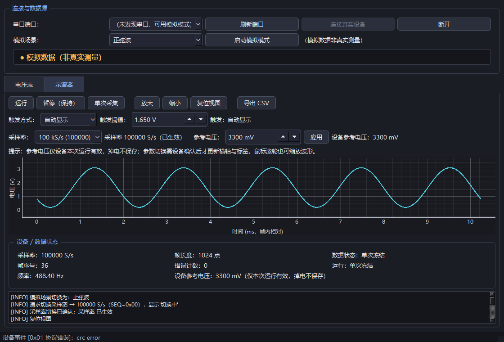

# STM32 电压表 + 示波器（第一版 · 教学用）

> 2026-11-09 Codex 复核版：已修正触发/单次采集、命令确认、数据来源标注和验证入口。
> 最新结果：83 项测试、40 项 Windows 桌面 GUI 检查通过，固件重新构建 0 错 0 警。
> **尚未接板实测**。最新变更和验证边界见 [Codex 复核报告](outputs/Codex复核报告.md)。

**第一次使用请从 [完整使用教程](docs/使用教程.md) 开始**：下载 → 安装 → 无硬件模拟试用 → 接线 → Keil 编译烧录 → 真实测量 → 导出与排错。



截图为模拟数据；当前软件测试 83 项、Windows Qt GUI 自动检查 40 项通过。硬件接线、真实采样时序、精度与带宽尚未验证；WorkBuddy 本轮自动审查未完成，不作为验收证据。

用「电协笔试」那套 STM32F103C8T6 最小系统板 + 电位器 + 0.96 寸 OLED，做一台**低压、低频、单通道**的教学仪器：

- **电压表**：OLED 独立显示直流电压；电脑端同时给大数字、平均值、最小值、最大值、峰峰值。
- **示波器**：电脑端显示**真实 ADC 等间隔采样**的电压—时间曲线，支持运行 / 暂停 / 单次 / 缩放 / 触发 / CSV 导出。
- 输入固定为相对板上 GND 的 **0～3.3 V**（PA0 / ADC1_IN0），不依赖任何外置模拟前端。
- 没接开发板也能用**明确标注的「模拟数据」模式**先把界面和流程跑通。
- 固件用 STM32F10x **标准外设库 + Keil MDK 5（ARMCC 5）**，驱动独立封装、中文注释讲原理，`main.c` 保持简洁。

> ⚠️ 这是面向初学者的第一版：它不是通用示波器。**超过 3.3 V、负电压、交流负半周、市电、高压测量都不在范围内**，PA0 接错会损坏芯片。详见 `docs/接线与硬件.md`。

---

## 目录结构

```
电压表和示波器/
├─ README.md                   本文件：接线 → 安装 → 运行 → 第一条真实曲线
├─ docs/
│  ├─ protocol.md              通信协议 v1（帧格式 / CRC / 命令 / 重同步 / golden 样例）★ 两端唯一依据
│  ├─ 接线与硬件.md            逐针接线表、首次测试、器件清单、输入边界与概念澄清
│  ├─ 上板验收.md              用户可照做的验收流程与「未实测项」清单
│  └─ 审查记录.md              只读交叉审查结论
├─ firmware/                   完整 Keil 工程（标准外设库 + 自研驱动）
│  ├─ Project.uvprojx          Keil 工程（Create HEX File 已开启）
│  ├─ Start/ Library/ System/ User/ Hardware/ Common/ Tests/
│  ├─ Objects/                 构建输出（build.log、.hex、.map）
│  ├─ build.ps1                命令行构建脚本
│  └─ README.md                固件设计说明（采样率推导、时序、引脚冲突、构建结果）
├─ desktop/                    电脑端 Python 软件 + 测试
│  ├─ main.py / main_window.py / protocol.py / processing.py
│  ├─ simulator.py / serial_worker.py
│  ├─ requirements.txt
│  ├─ tests/                   单元测试与 GUI 冒烟测试、原始输出日志
│  └─ screenshots/             GUI 实际截图
├─ outputs/                    交付入口与验证证据
│  ├─ 安装依赖.bat             创建项目内 .venv 并安装依赖
│  ├─ 启动仪器.bat             ★ 电脑端启动入口
│  ├─ 运行验证.bat             协议核对 + 单元测试
│  ├─ 协议交叉核对.py          主 agent 的跨实现核对脚本
│  ├─ 协议核对结果.txt / 验证日志.txt
│  ├─ 验证报告.md              ★ 统一验证报告（含未验证项）
│  └─ screenshots/             GUI 截图副本
└─ .venv/                      项目内虚拟环境（不进交付压缩包）
```

---

## 一、先接线（不接电脑也能当电压表用）

**最小接线**（电位器 + OLED，第一版必需）：

| 信号 | 开发板引脚 | 外设 | 说明 |
| --- | --- | --- | --- |
| ADC 输入 | `PA0` (ADC1_IN0) | 电位器中间脚（滑动端） | 只测 0～3.3 V，**绝不能接 5 V / 负电压 / 市电** |
| 电位器两端 | `3.3V` / `GND` | 电位器两端 | 旋到底分别约 3.3 V / 0 V |
| OLED SCL | `PB8` | OLED SCL | 软件 I2C，沿用笔试工程 |
| OLED SDA | `PB9` | OLED SDA | 同上 |
| OLED 电源 | `3.3V` / `GND` | OLED VCC / GND | 不要用 5 V 供电（模块支持才可，需现场确认） |

**要连电脑看波形时再加** USB 转 TTL 模块：

| USB-TTL | 开发板 | 注意 |
| --- | --- | --- |
| RXD | `PA9`（USART1_TX） | 交叉接 |
| TXD | `PA10`（USART1_RX） | 交叉接，**逻辑电平必须兼容 3.3 V** |
| GND | `GND` | **必须共地** |
| VCC | 一般**不接** | 开发板已由 USB/ST-Link 供电时不要并接两个 VCC；若需由模块供电，先确认电压与电流能力 |

可选：ST-Link V2 走 SWD 烧录（SWDIO / SWCLK / GND / 3.3V）；PA8 是 100 Hz 自检 PWM 输出，做自检时经限流电阻接 PA0，**且此时 PA0 不能再接外部信号**。

> 完整逐针表、首次上电步骤、"看到什么立刻断电"、已拥有 / 待确认 / 可选器件清单，见 **`docs/接线与硬件.md`**。
> USB 转 TTL 模块是否存在及其型号/电平、开发板晶振频率、实际电源电压都**需要你现场确认**，本文不把它们当成已核实事实。

---

## 二、安装并运行电脑端（Windows）

所有脚本都在 `outputs/` 下，用相对定位，兼容中文路径和带空格的路径，**不要求全局安装 Python 包**。

1. 双击 **`outputs\安装依赖.bat`**
   - 在**项目根目录内**创建 `.venv`，再按 `desktop\requirements.txt` 安装 PySide6 / pyserial / PyQtGraph 等。
   - 若提示找不到 Python，先装 Python 3.10+ 并勾选 "Add to PATH"。依赖装不上时请把 pip 原始输出留下排查。
2. 双击 **`outputs\启动仪器.bat`**
   - 程序初始为“等待设备”。没接板子时，选择模拟场景并点击“启动模拟模式”，来源栏会**显著标注“模拟数据”**；此时显示的波形不是真实测量。
   - 模拟源提供正弦、方波、直流，以及接近量程上下限、无触发、断线等可验证场景。
3. 双击 **`outputs\运行验证.bat`** 可重跑协议核对与单元测试，结果写入 `outputs\验证日志.txt`。

也可以手动运行（在项目根目录）：

```bat
.venv\Scripts\python.exe desktop\main.py
```

### 界面能做什么

| 功能 | 说明 |
| --- | --- |
| 视图切换 | 「电压表」大数字 + 平均/最小/最大/峰峰值；「示波器」电压—时间曲线 |
| 串口 | 端口下拉 + 刷新 + 连接 + 断开；状态栏区分「真实设备 / 模拟数据 / 已断开 / 等待设备」 |
| 采集控制 | 运行 / 暂停(保持) / 单次采集；暂停或单次冻结后后台新帧**不会**覆盖当前画面 |
| 采样率 | 10 kS/s / 100 kS/s；**只有收到设备的确认响应才更新横轴**，切换失败会回滚并提示 |
| 触发 | 自动 / 上升沿，阈值可调；未找到触发点显示「等待触发/未触发」，不伪造预触发数据 |
| 波形 | 横轴按设备上报采样率换算秒/毫秒，纵轴伏特；滚轮缩放、复位视图 |
| 导出 | CSV 含帧内时间、原始 ADC 码、换算电压，并写入采样率、参考电压、帧序号；文件头注明帧间不连续 |
| 校准 | 参考电压 `vref_mv` 可配置（默认 3300），界面显示设备当前值；**只改设备本次运行，掉电不保存** |

电压换算统一为 `V = code / 4095 × vref_mv / 1000`，OLED 与电脑端使用同一个 `vref_mv`。**不假定板上 3.3 V 恰好等于 3.300 V**。

> **运行期取舍**：串口命令在一帧处理完后的帧间执行，采集/发送期间先缓存。`SET_RATE` 在 RUN 状态会返回「设备忙」（`status=0x02`），请先暂停并等待停止确认，再切采样率，最后运行。`SET_VREF` 可以在帧间修改，只影响后续帧的电压换算。参数以设备回读为准；旧显示帧和导出的 CSV 保留其采集时的采样率、参考电压及来源。

上升沿触发模式下，未触发时保持同一帧的波形、统计和导出数据；单次采集会继续等待触发。真实设备每次 SINGLE 只采发一帧，电脑在未触发时会重新请求下一帧，可用暂停取消。运行/停止/单次均核对对应 SEQ 的响应，等待期间界面保持，不能把发送命令当作设备已经执行。

---

## 三、固件：构建与烧录

- 工程：`firmware\Project.uvprojx`，用 **Keil MDK 5 + ARM Compiler 5（V5.06 update 5）** 打开，设备 STM32F103C8（64 KB Flash / 20 KB RAM），启动文件 `startup_stm32f10x_md.s`，已勾选 **Create HEX File**。
- 命令行构建（PowerShell，在工程目录内）：

```powershell
$p = Start-Process C:\Keil_v5\UV4\UV4.exe -ArgumentList '-b','Project.uvprojx','-j0','-o','Objects\build.log' -WorkingDirectory . -WindowStyle Hidden -Wait -PassThru
Get-Content Objects\build.log; $p.ExitCode
```

  也可双击/运行 `firmware\build.ps1`。退出码 0 = 成功、1 = 有警告、2+ = 有错误。**本次实际构建结果见 `outputs\验证报告.md`，不要把"工程文件存在"当成"编译成功"**。
- 生成的可烧录文件为 `firmware\Objects\Project.hex`（若工程输出名不同，以 `firmware\README.md` 记录为准）。用 ST-Link V2 走 SWD 烧录，**本项目不会自动烧录硬件**。

### 采样是怎么做到等间隔的

不是主循环 `printf` 一串数再连线。链路是：

```
TIM3 更新事件（TRGO） → 硬件触发 ADC1 规则组转换 → DMA1_Channel1 搬到 g_adc_buf[1024]
→ 采满 1024 点后 DMA 传输完成中断置标志 → 主循环停止 TIM3/ADC 触发/DMA
→ 通过 USART1 发送这一整帧 → 发完才重新配置并启动下一帧
```

- ADC 时钟 = PCLK2/6 = 72 MHz/6 = **12 MHz**（不超过 14 MHz）；采样时间 55.5 cycles + 12.5 cycles = 68 cycles ≈ **5.667 µs**。
- 100 kS/s 的触发间隔是 10 µs > 5.667 µs，**时序相容**；10 kS/s 间隔 100 µs。TIM3 时钟为 72 MHz：10 kS/s 用 `PSC=0, ARR=7199`，100 kS/s 用 `PSC=0, ARR=719`。
- F103 中容量 ADC1 规则组的外部触发源经库头文件核对为 `ADC_ExternalTrigConv_T3_TRGO`（**没有** TIM2_TRGO / TIM8_TRGO，那是别的系列/ADC3），所以选 TIM3 TRGO 更新事件。
- 采用「采一帧 → 停 → 发一帧」，**帧间有空隙**。115200 8N1 约 11.5 kB/s，一帧 2070 字节约 180 ms，本项目**不声称**可以连续无损传输 100 kS/s 的 uint16 流。
- 100 kS/s 是**设计目标，不是实测指标**；采样率 ≠ 带宽，还受采样时间、信号源阻抗、前端模拟带宽与混叠影响。
- PA8 的 100 Hz PWM 只是**自检信号**，用来确认链路能出波形，不能证明高速带宽或绝对精度。

引脚占用：PA0(ADC1_IN0)、PA8(TIM1_CH1 自检 PWM)、PA9/PA10(USART1)、PB8/PB9(软件 I2C OLED)、TIM3(内部触发，不占引脚)，互不冲突；详见 `firmware\README.md` 与 `docs\审查记录.md`。

---

## 四、拿到第一条真实曲线

1. 按第一节接线并**断电复核**；确认 PA0 上只有 0～3.3 V，USB-TTL 是 3.3 V 逻辑且已共地。
2. 烧录 `firmware\Objects\Project.hex`，上电。**先只看 OLED**：旋转电位器，OLED 上的平均/最小/最大电压应随之变化；没有电脑也必须能工作。
3. 打开 `outputs\启动仪器.bat`，**先在模拟模式**点一遍运行/暂停/单次/缩放/导出，确认软件本身没问题。
4. 切到「真实设备」：在端口下拉选择 USB-TTL 的 COM 口（点「刷新」重新枚举），点「连接」，状态栏应显示真实设备。
5. 点「运行」→ 波形出现。缓慢旋转电位器，曲线应跟着上下移动；静止时接近一条水平线。
6. 电位器只能产生变化的直流电压。周期波形可使用已确认在 0～3.3 V 范围内的信号源；PA8 自检 PWM 默认关闭，**当前 GUI 没有启用按钮**，需另用协议命令开启，详见 [教程第 6 节](docs/使用教程.md#6-触发周期波形与自检的范围)。自检接线前断电并移除电位器滑动端，不能两个信号源同时驱动 PA0。
7. 点「导出 CSV」，检查文件头里的采样率、`vref_mv`、帧序号，以及每帧时间轴从 0 开始。
8. 切换 10 kS/s ↔ 100 kS/s，确认界面显示的是**设备回读的实际采样率**后再看横轴变化。

完整验收判据与失败排查见 **`docs\上板验收.md`**。

---

## 五、通信协议（摘要）

二进制帧，小端，USART1 115200 8N1：

```
A5 5A C3 3C | VER=01 | TYPE | LEN(2B) | SEQ | FLAGS | PAYLOAD | CRC16(2B)
```

- `TYPE`：`0x10` 采样帧 / `0x20` 命令 / `0x21` 响应 / `0x22` 事件；命令与响应靠 TYPE 和 SEQ 回显区分。
- 采样帧 payload 带**真实采样率**、点数、`vref_mv` 和 1024 个 12 位原始码；电脑端时间轴按该采样率计算，且每帧从 0 起。
- CRC 为 CRC-16/CCITT-FALSE（`0x1021` / 初值 `0xFFFF`），覆盖 VER 到 payload 末，帧内低字节在前。
- 接收端必须做字节流重同步：任意分片、合并帧、噪声、CRC 错、非法长度、截断包都要能恢复；`LEN ≤ 2060`，缓冲区上限 8192 字节。
- **禁止**把调试 `printf` 混进采样串口；采样参数变更必须得到设备显式确认才算生效。

完整定义、命令表、重同步规则、三个已核对 CRC 的完整十六进制样例与跨实现核对方法，见 **`docs\protocol.md`**。

---

## 六、验证与限制

统一验证报告：**`outputs\验证报告.md`**（含构建日志、协议核对、单元测试、GUI 交互、截图路径与未验证项）。

边界必须说清楚：

1. **本机只做软件与工程层面的验证**：Keil 命令行构建、协议跨实现核对、电脑端单元测试、GUI 实际启动与交互、截图。每一项**是否真的执行、结果如何，一律以 `outputs\验证报告.md` 和原始日志为准**；工程文件存在不等于编译成功，能导入不等于 GUI 交互验证通过。
2. **没有做真实硬件验证**：接线、烧录、串口通信、采样时序、精度、带宽、100 kS/s 实际波形质量、晶振与电源电压均**未实测**。`docs\上板验收.md` 给出用户可照做的验收步骤。
3. **模拟数据不是测量**：界面会显著标注来源；断线会显示断开并冻结历史帧，不会假装在线刷新。
4. **协议核对的边界**：本机没有可在 PC 上执行的 x86 C 编译器，跨实现证据由 ARMCC 编译期 `#if` 常量断言 + Python 独立解析 C 源码中的人工 golden 字节构成；运行级的「C 编码↔Python 解码」双向核对列为待补项，详见 `docs\protocol.md` 第 8 节与 `outputs\验证报告.md` 第 7 节。

---

## 七、许可与来源

- 固件基于 STMicroelectronics **STM32F10x_StdPeriph_Lib V3.5.0**（源文件随工程附在 `firmware/Library/`，保留原版权声明），以及用户「电协笔试」练习工程里的 OLED 软件 I2C 驱动与工程结构。
- 电脑端第三方库见 `desktop\requirements.txt`（PySide6 / pyserial / PyQtGraph 等，各遵循其自身许可）。
- 本项目自写部分按教学用途提供，不含原笔试工程里的视频、旧构建结果与舵机逻辑；原参考工程未被修改。
- 第三方组件来源与许可索引见根目录 **`THIRD_PARTY_NOTICES.md`**（随交付 ZIP 一起提供）。
