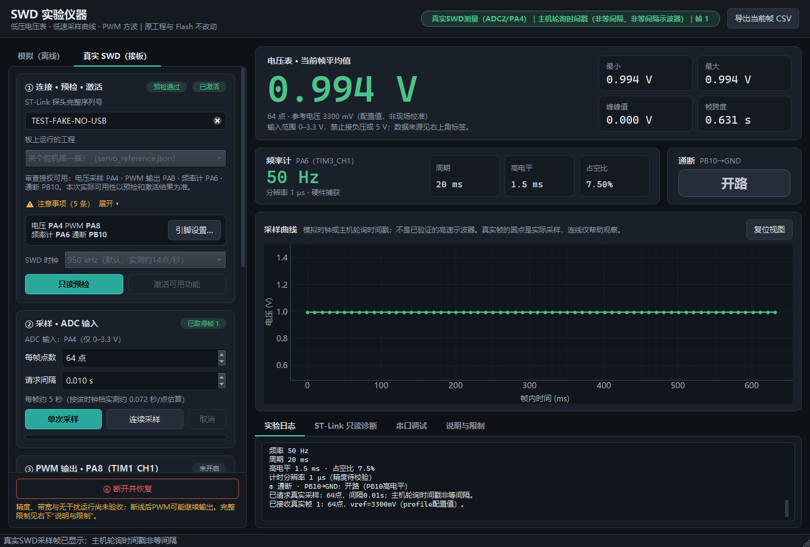

# STM32 SWD 实验仪器：电压表 · 低速采样曲线 · PWM 输出 · 频率计 · 通断

用一块 ST-Link 调试器，把一块**正在运行自己程序**的 STM32F103C8 板子当成简易仪器来用：

- 不改原工程源码，不重新烧录，不暂停、不复位，原程序照常运行；
- 电脑通过 SWD 调试口，临时接管芯片上**原程序没在用**的 ADC、定时器和引脚；
- 用完点“断开并恢复”，接管过的寄存器字段写回原样。

适合在调试单片机课程项目时，顺手测一下引脚上的电压、看一个慢信号、给某个输入喂一个方波、量一下舵机 PWM 的脉宽，或者检查一根线有没有接地。



> 截图使用测试替身数据，界面元素与真实接板时一致。

---

## 能做什么

| 功能 | 默认引脚 | 能力 | 不能做 |
| --- | --- | --- | --- |
| 电压表 | ADC2 · PA4 | 0～3.3 V 直流电压，平均/最小/最大/峰峰值 | 负压、5 V 以上、电流、电阻 |
| 采样曲线 | 同上 | 主机经 SWD 逐点轮询，约 14 点/秒，真实时间戳 | 高速示波器；点间隔不等，快信号会混叠 |
| 信号发生器 | TIM1_CH1 · PA8 | 3.3 V 逻辑方波 / PWM，0.1 Hz～100 kHz | 正弦、三角、可调幅值（芯片没有 DAC） |
| 频率计 | TIM3_CH1 · PA6 | 定时器硬件捕获，0.5 Hz～100 kHz，频率/周期/高电平/占空比，自动量程 | 单次脉冲、非逻辑电平信号 |
| 通断 | PB10 | 内部上拉，判断某点是否接到 GND | 测电阻；外加电压 |
| 串口调试 | USB 转串口模块 | 收发文本/HEX，常用波特率 | — |

所有引脚都可以在软件里改（见“引脚设置”）。

## 实测验证

在一块江协科技教程风格的 STM32F103C8 面包板上，用 ST-Link V2 实测（SWD 950 kHz）：

| 项目 | 结果 |
| --- | --- |
| 接地电压 | PA4 接 GND，ADC 码 0～4，平均约 0.5 mV |
| PWM → ADC 回环 | PA8 输出 1 Hz 方波接到 PA4，曲线高低交替，ADC 码 0～4095 |
| 频率计回环（PA8 → PA6） | 50 Hz 舵机信号读出 49.999 Hz、高电平 1.500 ms；988 Hz、1 kHz 读数与输出一致；20 kHz、100 kHz 误差为 ±1 个计时单位（13.9 ns） |
| 通断 | PB10 悬空判“开路”，接 GND 判“导通” |
| 采样速度 | SWD 100 kHz 时约 2.9 点/秒，950 kHz 时约 14 点/秒，1.8 MHz 时约 17.5 点/秒 |
| 取消测量 | 频率计测到一半时取消，其他功能保持可用 |
| 恢复 | 每轮结束读回确认输出关闭，接管过的寄存器恢复，完整 64 KiB Flash 摘要不变，目标保持运行 |

**还没有验收的**：电压绝对精度（参考电压按 3.3 V 配置值计算，没有用独立仪表校准）、频率的独立精度（频率计和信号发生器共用同一个时钟）、对原程序时序的影响、默认以外的可选引脚。

## 需要什么

- STM32F103C8（DEV_ID 0x410，64 KiB Flash）开发板，板上运行你自己的程序
- ST-Link V2 调试器：SWDIO→PA13、SWCLK→PA14、GND→GND
- Windows、Python 3.13
- 杜邦线若干；不需要额外的电子元件

## 安装与启动

```bat
:: 在仓库根目录
py -3.13 -m venv .venv
.venv\Scripts\python.exe -m pip install -r swd_instruments\requirements.txt
```

或者直接双击 `swd_instruments\安装SWD依赖.bat`。之后双击 `swd_instruments\启动SWD仪器.bat` 启动。

启动时不会连接任何硬件。没有板子也可以先在“模拟（离线）”页熟悉界面，模拟数据始终标注为模拟。

## 使用步骤

左侧“真实 SWD（接板）”页从上到下就是操作顺序：

1. **连接**：填 ST-Link 完整序列号，选择板上运行的工程（见下文“固件识别”），点“只读预检”。预检只读不写。
2. **激活**：预检通过后点“激活可用功能”。只有原程序没在用、且此刻空闲的功能会被激活。
3. **测量 / 输出**：
   - **② 采样**：被测信号接 ADC 引脚，点“单次采样”或“连续采样”。
   - **③ PWM 输出**：设频率、占空比，点“开启 / 更新输出”；用完点“关闭输出”。
   - **④ 频率计**：信号接频率计引脚，点“测量一次”或“连续测量”。10 Hz 以下的慢信号请把超时改成“慢信号 10 s”或“很慢 30 s”。
   - **⑤ 通断**：一根线接通断引脚，另一端碰被测点，点“检查通断”。
4. **结束**：点最下方的“断开并恢复”。不要直接拔线或关窗口，否则 PWM 可能继续输出。

右侧同时显示电压表、频率计和通断的读数，以及采样曲线和实验日志。

### 自测回环（不需要别的硬件）

接两根跳线：PA8→PA4、PA8→PA6。

1. PWM 设 1 Hz，开启输出，然后单次采样：曲线上应出现方波。
2. PWM 改成 50 Hz、7.5%，然后测量一次：频率计应显示约 50 Hz、高电平 1.5 ms。
3. 关闭输出，断开并恢复。

## 引脚设置

点①卡片里的“引脚设置…”可以给每个功能换引脚。下拉框只列出同时满足以下条件的引脚：

- 芯片硬件支持该功能，且不需要 AFIO 重映射；
- 当前工程没有用到；
- 没有被你标记为“物理占用”。

| 功能 | 可选范围 |
| --- | --- |
| 电压采样 | PA0～PA7、PB0、PB1 |
| 频率计 | TIM1/TIM2/TIM3/TIM4 的通道 1、2 |
| PWM 输出 | TIM1～TIM4 的 16 个输出通道 |
| 通断 | 除 SWD/JTAG 引脚外的大部分 PA、PB |

同一个引脚或定时器只能给一个功能用。对话框会标出每个引脚是否耐 5 V：PA0～PA7、PB0、PB1、PB5 只能接 0～3.3 V。

“物理占用引脚”默认勾选 PB6～PB9。江协教程布局里 OLED 模块的 GND/VCC/SCL/SDA 正好插在这四排，往这几排接仪器跳线可能把输出短接到 OLED 电源上。

## 固件识别与安全设计

软件只在确认安全的前提下才写寄存器：

- **固件识别**：预检会读出板上完整的 64 KiB Flash 并计算 SHA-256。与已登记工程一致时，自动使用该工程审查过的资源表。仓库自带 8 个课程练习工程的登记档案（`swd_instruments/profiles/`）。
- **通用模式**：板上是未登记的程序时，选择“通用模式（未登记固件）”。只读预检仍会确认所选外设和引脚此刻空闲；激活前会弹窗请你确认风险。原程序如果在测量途中才启用同一个外设，可能互相干扰，软件能检测到大部分这类变化并停止，但不能保证零影响。通用模式下永远不改 ADC 时钟分频。
- **写入白名单**：只允许写当前所选功能的固定寄存器字段，并且只写掩码内的位。没有任意地址读写入口。
- **不碰原程序的东西**：不读 ADC1 数据寄存器，不改 AFIO 重映射、全局时钟、中断和 SWD 引脚。
- **可恢复**：每次写入都记录原值；断开时只恢复本工具持有、且没有被原程序改动过的字段，被改动过的字段宁可跳过并报告。
- **如实报告**：PWM 只有读回确认后才显示“已关闭”；会话被驱动撤销时界面立即提示；真实数据和模拟数据始终分开标注。

> “不改源码、不改 Flash”不等于物理上零影响：SWD 访问和寄存器读改写与原程序之间仍有极小的竞争窗口。

## SWD 时钟

采样慢的主要原因是每个采样点前后都要读一轮保护寄存器。提高 SWD 时钟不会减少任何检查，只缩短每次访问的时间。默认 950 kHz；接线不稳、出现通信错误时，在①卡片里改成更低的档位。

## 常见问题

| 现象 | 处理 |
| --- | --- |
| 预检报 `USB Error: [Errno 5] Input/Output Error` | 探头连接中断过。点“断开并恢复”，关闭软件，重新插拔 ST-Link 后再打开 |
| 预检报固件摘要不匹配 | 板上不是所选工程。选对应工程，或改用“通用模式” |
| 频率计一直“无信号” | 检查接线；慢信号请改用慢速超时档 |
| 某个功能卡片是灰的 | 卡片上会写原因：固件占用了该资源、引脚被标记占用，或此刻不空闲 |
| 出现红色“输出状态未知” | 软件无法确认 PWM 已关闭。检查输出引脚上接的东西，必要时给板子断电 |

## 目录结构

```
swd_instruments/
├─ gui.py              PySide6 界面（左侧操作、右侧读数、引脚设置对话框）
├─ theme.py            深色主题样式
├─ hardware.py         真实控制器：预检、激活、采样、PWM、频率计、通断、恢复
├─ selectable.py       可选引脚与通用模式控制器
├─ pins.py             STM32F103C8 引脚与定时器候选表、写入掩码
├─ transport.py        pyOCD 传输层：只读白名单、受限写入、写入授权
├─ profiles.py         固件档案加载与可信登记
├─ core.py             寄存器地址、时钟推导、数据帧、模拟器
├─ contracts.py        界面与驱动之间的数据结构
├─ serial_terminal.py  串口调试页
├─ profiles/           已登记工程的档案（JSON）与参考固件（HEX）
└─ tests/              回归测试（使用寄存器级测试替身，不连接硬件）
docs/screenshots/      界面截图
```

更细的寄存器级设计、档案格式和每项限制见 [swd_instruments/README.md](swd_instruments/README.md)。

## 测试

```bat
.venv\Scripts\python.exe -m unittest discover -s swd_instruments\tests
```

共 199 项，使用模拟 STM32F1 寄存器、自清零位、捕获时序和故障的测试替身，不连接 USB。测试通过不等于硬件验收。

## 旧版本

本仓库最初是一个“串口版”电压表和示波器：需要给板子烧录专用固件，通过串口把 ADC 数据发到电脑。它已被本版本取代并从仓库中移除，需要时可在提交历史中找到。旧版固件会占用 TIM1，不能与本工具同时使用。

## 第三方组件

见 [THIRD_PARTY_NOTICES.md](THIRD_PARTY_NOTICES.md)。
