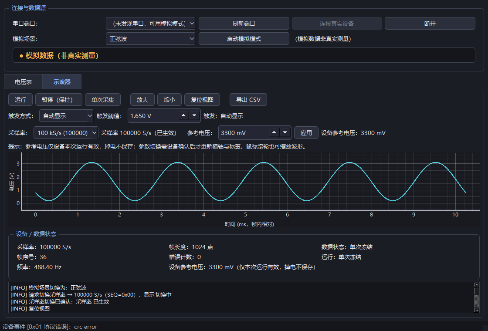

# 使用教程：从模拟试用到真实测量

适用平台：Windows；硬件目标为 STM32F103C8T6。电脑端已在 Python 3.13、PySide6 6.12.0 下验证。本文的接线、烧录和真实测量步骤仍需用户在实物上执行，目前没有硬件验收结果。

## 1. 下载项目

在仓库首页点击 **Code → Download ZIP**，解压到普通用户可写的文件夹。不要直接在压缩包内运行。后文“项目根目录”指能看到 README.md、desktop、firmware、outputs 的这一层。

已安装 Git 也可以运行：

```powershell
git clone https://github.com/Starverse032/stm32-voltmeter-oscilloscope.git
cd stm32-voltmeter-oscilloscope
```

## 2. 不接开发板，先试电脑软件

1. 安装 64 位 Python，建议 3.13，并启用 Add Python to PATH。项目依赖固定 PySide6-Essentials 6.12.0，过新或过旧的 Python 可能没有对应安装包。
2. 双击 `outputs/安装依赖.bat`，等待出现安装完成。依赖写入项目内 `.venv`，需要联网下载。
3. 双击 `outputs/启动仪器.bat`。初始显示“等待设备”，此时没有测量数据。
4. 在“模拟场景”选择“正弦波”，点击 **启动模拟模式**。确认黄色标记为“模拟数据（非真实测量）”。
5. 切换到 **示波器** 标签页，查看横轴毫秒、纵轴伏特的曲线。
6. 点击 **暂停（保持）**：显示应停止更新；点击 **运行**：恢复刷新。
7. 点击 **单次采集**：接纳一帧后冻结。若使用上升沿触发，必须等到满足触发条件才冻结；无触发时可用暂停取消等待。
8. 使用“放大 / 缩小 / 复位视图”，或在绘图区滚轮缩放。
9. 点击 **导出 CSV**，选择保存路径。只有已显示数据后才有可导出的帧。
10. 切回 **电压表**，查看平均值、最小值、最大值与峰峰值。选择“断线”模拟场景，可验证断线提示和历史数据冻结。



截图来自自动测试，含有为验证错误处理而注入的状态信息；不是实测波形或测量精度证明。

手动安装和启动（在项目根目录运行）：

```powershell
py -3.13 -m venv .venv
.\.venv\Scripts\python.exe -m pip install -r desktop\requirements.txt
.\.venv\Scripts\python.exe desktop\main.py
```

## 3. 准备硬件并断电接线

基本器件：STM32F103C8T6 最小系统板、适配的 ST-Link/SWD 下载器、3.3 V 电位器信号、I2C OLED（与项目驱动兼容）、杜邦线。电脑端真实测量另需 **3.3 V 逻辑电平的 USB-TTL**。这是使用所需器件清单，不代表已确认用户拥有全部器件。

**PA0 只允许相对板上 GND 的 0～3.3 V 输入。不能接 5 V、负电压或市电。** 第一次只用板载 3.3 V 和电位器产生信号。

| 开发板 | 接到哪里 |
| --- | --- |
| 3.3V / GND | 电位器两端 |
| PA0 | 电位器中间滑动端 |
| PB8 / PB9 | OLED SCL / SDA |
| 3.3V / GND | OLED VCC / GND（确认模块兼容） |
| PA9（TX） | USB-TTL RXD |
| PA10（RX） | USB-TTL TXD |
| GND | USB-TTL GND，共地 |

板子已有独立供电时，一般不要再接 USB-TTL VCC。下载器 SWD 接线按板上丝印核对：SWDIO、SWCLK、GND 和下载器要求的目标电压参考/供电；不要把参考电压脚一律当作电源输出。完整说明见 [接线与硬件](接线与硬件.md)。

## 4. 编译与烧录固件

1. 安装并配置 Keil MDK 5、ARM Compiler 5，以及工程要求的 STM32F1 设备包。工程目标是 STM32F103C8，64 KB Flash / 20 KB RAM。
2. 打开 `firmware/Project.uvprojx`，确认编译器为 ARMCC 5；不要直接把其他芯片或 HAL 工程配置套进来。
3. 点击 **Rebuild**。检查完整构建输出，应无错误；HEX 输出到 `firmware/Objects/Project.hex`。
4. 在 **Options for Target → Debug** 选择实际下载器；ST-Link 通常使用 **ST-Link Debugger**，进入 Settings 选择 SW，并确认识别到目标芯片。下载算法须匹配 STM32F1 中容量器件。
5. 确认供电、接线与芯片型号后，由使用者点击 **Download** 烧录；必要时复位或重新上电。
6. 先不连接电脑软件，旋转电位器，检查 OLED 上的平均/最小/最大电压是否随之变化。

仓库保留已生成的 HEX 和历史构建日志，供参考；在自己的环境重新编译更便于核对来源。工程使用的时钟假设、资源及限制见 [固件说明](../firmware/README.md)。不能将编译成功当作上板成功。

本机 Keil 位于 `C:\Keil_v5\UV4\UV4.exe` 时，可以在 PowerShell 运行：

```powershell
& .\firmware\build.ps1
```

其他安装路径请在脚本内修改 `$Keil`，或直接使用 Keil 界面构建。

## 5. 连电脑测量电位器电压

1. 退出可能占用串口的终端软件。USB-TTL 接入电脑，在设备管理器确认 COM 号；看不到端口时先处理该模块的驱动。
2. 打开仪器，点击 **刷新端口**，选择对应 COM，点击 **连接真实设备**。确认来源显示真实设备；“模拟数据”表示尚未在测板子。
3. 触发方式先选 **自动显示**，点击 **运行**，等待命令确认和采样帧。
4. 缓慢旋转电位器。直流输入通常接近一条水平线，旋转时线上下移动；这也是正常的示波器曲线。
5. 切换“电压表”，比较 OLED 与电脑端读数。输入悬空时读数漂移是正常现象，不能用来判断零伏。
6. 调整采样率时，先 **暂停并等待 STOP 确认 → 选择 10 kS/s 或 100 kS/s → 等待已生效 → 运行**。运行中设备会拒绝改采样率。
7. 参考电压默认 3300 mV。如有可靠仪表测得 ADC 参考电源，可输入实际值并点击“应用”，以设备确认值为准。该设置仅本次运行有效，掉电后不保存。

实际电源不一定等于 3.300 V。软件电压按 `ADC码 / 4095 × 参考电压` 换算；显示三位小数不代表已达到毫伏级测量精度。

## 6. 触发、周期波形与自检的范围

自动显示适合首次连通和直流信号。上升沿触发适合已知周期信号：把阈值设在信号低、高电平之间，等待曲线对齐；直流不跨越阈值时会显示未触发，并保留上一帧。

固件包含 PA8 的 100 Hz PWM 自检输出，**默认关闭，当前 GUI 没有启用按钮**。开启需要通过协议发送 `CMD_SELFTEST_PWM (0x07)`，封包函数是 `desktop/protocol.py` 的 `build_selftest_pwm(enable, seq)`，详见 [通信协议](protocol.md)。普通首次使用无需开启此功能，也不能把“打开自检”理解成界面上已有按钮。

自行使用协议工具开启前，先断电移除电位器滑动端，再按 [硬件说明](接线与硬件.md) 将 PA8 经限流电阻接到 PA0；不得由两个信号源同时驱动 PA0。自检只能验证链路，不能证明带宽或精度。外部信号源同样必须符合 0～3.3 V、共地要求。

## 7. 导出 CSV 与理解采样率

暂停或单次冻结后导出，便于记录指定的一帧。CSV 含帧序号、帧内索引、时间（秒）、原始 ADC 码、电压，以及采样率、参考电压和来源信息。模拟数据导出仍标为模拟来源。

每帧固定 1024 点，时间从 0 开始：10 kS/s 相邻点间隔 0.1 ms，100 kS/s 为 0.01 ms。固件采用采一帧、停采、发送一帧的方式，**帧与帧之间存在空隙**；CSV 不能直接拼成连续时间流。100 kS/s 是配置目标，实际时序、模拟带宽和精度尚待硬件验证。

## 8. 运行验证与排错

双击 `outputs/运行验证.bat`，或运行：

```powershell
.\.venv\Scripts\python.exe outputs\最终验证.py
.\.venv\Scripts\python.exe desktop\tests\gui_smoke.py
```

第一条运行协议核对、电脑端测试、交付物检查；它只读取既有固件构建日志，**不会重新编译固件**。第二条会打开真实 Qt 窗口，自动运行 GUI 检查并保存截图，不是人工鼠标测试。日志分别在 `outputs/验证日志.txt`、`desktop/tests/GUI_OUTPUT.txt`。

| 现象 | 优先检查 |
| --- | --- |
| 依赖安装失败 | 建议使用 64 位 Python 3.13；查看 pip 原始错误、网络和包兼容性 |
| 没有 COM 端口 | USB-TTL 驱动、数据线、设备管理器和刷新按钮；模拟模式仍可使用 |
| 端口无法打开 | 是否被其他软件占用；选择的 COM 是否正确 |
| 有连接但无波形 | RX/TX 交叉、共地、115200 8N1、固件是否烧录；先选自动显示 |
| 命令超时 | 等待帧间处理，核对串口链路；重新连接后读取设备状态，不能假定命令已生效 |
| 单次一直等待 | 上升沿阈值是否被信号跨越；改自动显示排查，暂停可取消等待 |
| 采样率切换被拒绝 | 先暂停并等待设备确认，再切换 |
| OLED 和电脑数值异常 | 输入接线、共地、参考电压；悬空输入不代表零伏 |

完整实物验收步骤见 [上板验收](上板验收.md)。软件检查通过与实物验收完成是两项独立结论。
